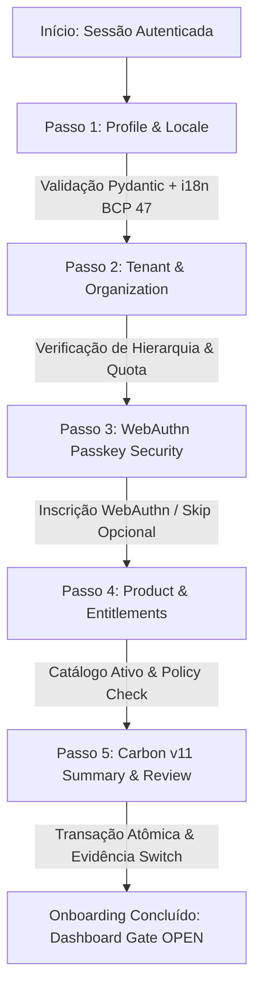

# generative-os — Arquitetura Canônica de Onboarding, Tenancy e Passkeys (v3.1)

**Projeto-alvo:** `cestari-studio/generative-os` (branch de referência `feat/complete-carbon-page-rebuild`).  
**Referência Ontológica Normativa:** `cestari-studio/genOS` (read-only, commit `ffd97fa93ab425fff6bac5015d34944ef924090c`).  
**Data da Versão:** 31 de Outubro de 2026.  
**Conformidade de Governança:** [mellea/GOVERNANCE.md](file:///Users/cestari/Developer/generative-base/mellea/GOVERNANCE.md), [PI_SETUP.md](file:///Users/cestari/Developer/generative-base/mellea-skills-compiler/docs/PI_SETUP.md) e [generative-os-ai-execution-blueprint-v3.md](file:///Users/cestari/generative-os/docs/ui-rebuild/generative-os-ai-execution-blueprint-v3.md).

---

## 1. Sumário Executivo e Decisão de Arquitetura

Este documento estabelece o contrato definitivo, unificado e auditável para o fluxo de **Autenticação, Onboarding de Tenancy, Gestão de Roles/Entitlements e Inscrição de Passkeys (WebAuthn)** no `generative-os`.

Ele substitui as abordagens divergentes anteriores (`OnboardingFullPage` com 5 etapas desconectadas e `OnboardingTearsheet` com 4 etapas concorrentes) por uma **Máquina de Estados de Jornada Server-Authoritative** gerida pelo runtime **Mellea Core 2.0**, compilada via **Mellea Skills Compiler** com o backend de terminal **pi** (`@earendil-works/pi-coding-agent`), ancorada na ontologia de risco do **AI Atlas Nexus** (LinkML) e supervisionada pelos adaptadores locais do **Granite Switch 4.1 3B** (`granite-switch:3b-preview-q4`).

### 1.1 Princípios Fundamentais (Fail-Closed Governance)

1. **Separação Rígida entre Autenticação e Configuração:**
   - O login e a recuperação de credenciais utilizam estritamente **Carbon Core v11** (`Form`, `TextInput`, `PasswordInput`, `Button`, `Link`, `InlineNotification`), conforme a **Opção 3** aprovada.
   - Padrões de criação IBM Products (`CreateFullPage`, `CreateTearsheet`) ficam restritos exclusivamente às superfícies de onboarding e provisionamento organizacional.
2. **Ledger Server-Authoritative Único:**
   - Nenhuma etapa é concluída por mero clique em "Avançar" no browser. O estado da jornada é mantido de forma idempotente e versionada (`run_id`, `step_key`, `validation_state`), impedindo que heurísticas locais no frontend desbloqueiem o Dashboard.
3. **Ontologia Canônica de Tenancy:**
   - `persons.account_type` (`individual` vs `organization_member`) classifica unicamente o indivíduo; **nunca** concede autoridade nem cria organizações automaticamente.
   - A árvore hierárquica (`Master` → `Agency` → `Tenant` / `Unit` / `Sandbox`) é validada no servidor com controle de ciclos, profundidade e quotas.
4. **Verificação de Passkeys sem Falsos Vazios:**
   - O estado de credenciais WebAuthn é modelado como uma união discriminada (`checking`, `ready`, `unknown/error`, `unsupported`). O fallback para magic link/senha permanece ativo sem degradar falhas de rede em "sem credenciais cadastradas".
5. **Supervisão Neurosimbólica e Governança:**
   - Em conformidade com o `mellea/GOVERNANCE.md`, o código de orquestração herda total responsabilidade sobre cada mutação submetida. O Granite Switch avalia os sinais de evidência (`answerability`, `requirement-check`, `guardian-core`), e o AI Atlas Nexus cataloga cada risco ontológico antes de qualquer escrita no banco de dados.

---

## 2. Máquina de Estados Canônica de Onboarding (5 Passos)

A jornada canônica de onboarding é formalizada como um grafo dirigido acíclico (DAG) determinístico, onde cada transição exige validação por schemas Pydantic no Mellea e registro no ledger SQLite/Supabase.



### 2.1 Detalhamento dos Passos

| Passo | Rota / Identificador | Finalidade & Contrato de Dados | Componentes Carbon v11 | Validação & Guardrail Granite Switch |
| :--- | :--- | :--- | :--- | :--- |
| **1. Profile & Locale** | `/onboarding/profile` (`step_profile`) | Coleta `full_name`, `avatar_url` opcional e `preferred_locale` (BCP 47 canônico: `pt-BR`, `en-US`, `de-DE`, `ja-JP`, `zh-CN`). | `TextInput`, `Dropdown`, `InlineNotification` | `requirement-check`: conformidade de campos Carbon v11; `guardian-core`: sanitização de strings. |
| **2. Tenant & Org** | `/onboarding/tenant` (`step_tenant`) | Define se o usuário ingressa em organização existente via convite, solicita acesso ou provisiona novo tenant (`client`, `unit`, `sandbox`). Valida `tax_id` somente sob jurisdição aplicável. | `Form`, `RadioButtonGroup`, `TextInput`, `Select` | `guardian-core`: prevenção de escalada de privilégios (`org_owner` spoofing) e injeção em RPC. |
| **3. WebAuthn Passkeys** | `/onboarding/security` (`step_security`) | Inscrição opcional de chave de segurança FIDO2/WebAuthn via `@supabase/auth-js`. Fornece fallback transparente para Magic Link e Senha. | `Button`, `Tag`, `InlineNotification`, `Modal` | `answerability`: assistência contextual para configuração de autenticador biométrico/FIDO2. |
| **4. Products & Plans** | `/onboarding/products` (`step_products`) | Seleção dos produtos canônicos ativos (`Content Factory`, `AcademyOps`, `ScheduleOps`, `ReputationOps`, `ClientOps`) com base nos entitlements liberados. | `TileGroup`, `SelectableTile`, `Badge` | `requirement-check`: garantia de que apenas produtos mapeados e com runtime testado são selecionáveis. |
| **5. Review & Provision** | `/onboarding/review` (`step_review`) | Exibição de resumo consolidado, diff transacional e acionamento do comando atômico de provisionamento. Nenhum efeito colateral ocorre antes deste passo. | `StructuredList`, `Button` (Submit com loading real), `InlineLoading` | `judge_signal` completo: emissão de recibo auditável no `ledger.db` e validação Ajv. |

---

## 3. Integração com o Stack Neurosimbólico

### 3.1 Mellea Core 2.0 (Pydantic & Fail-Closed Assertions)

O motor de orquestração [`orchestration/mellea_onboarding_compiler.py`](file:///Users/cestari/generative-os/orchestration/mellea_onboarding_compiler.py) implementa os contratos de dados usando classes Pydantic v2 com validação estrita (`extra="forbid"`):

- `UserProfileStep`: validação de nome e localidade BCP 47.
- `TenantCreationStep`: validação do tipo de organização (`platform_operator`, `creative_agency`, `holding`, `network`, `client`, `unit`, `sandbox`), identificador canônico e autoridade.
- `PasskeySecurityStep`: estado discriminado da credencial WebAuthn (`status in ["registered", "skipped", "unsupported"]`).
- `ProductSelectionStep`: lista allowlisted de produtos e chaves de operação autorizadas.
- `OnboardingJourneyPayload`: composição completa da transação com `idempotency_key`, `actor_id` e `correlation_id`.

As asserções e reparos utilizam a semântica `SamplingStrategy._sample` com fail-closed estrito: falhas de transporte, timeouts ou saídas inesperadas resultam imediatamente em `ERROR` ou `UNCERTAIN`, nunca em `PASS`.

### 3.2 Mellea Skills Compiler e Integração com `pi`

A jornada de onboarding é compilada como uma skill certificada do Mellea através do agente de terminal **pi** (`@earendil-works/pi-coding-agent`), substituindo definitivamente ferramentas legadas (Claude Code e Bob):

```bash
# Compilação da skill de onboarding usando pi e Ollama local
mellea-skills compile \
  /Users/cestari/generative-os/orchestration/skills/onboarding/spec.md \
  --backend pi \
  --provider ollama \
  --model granite-switch:3b-preview-q4 \
  --output /Users/cestari/generative-os/orchestration/skills/onboarding/dist

# Validação e certificação determinística
mellea-skills validate /Users/cestari/generative-os/orchestration/skills/onboarding/dist
mellea-skills certify /Users/cestari/generative-os/orchestration/skills/onboarding/dist \
  --risk-model granite-switch:3b-preview-q4
```

A extensão do Mellea Skills instalada em `~/.pi/agent/extensions/pi` permite a execução de comandos interativos (`/mellea-compile`, `/mellea-validate`, `/mellea-run`, `/mellea-certify`) diretamente na sessão do agente.

### 3.3 AI Atlas Nexus (Ontologia LinkML & Governança de Risco)

Os riscos operacionais da jornada de onboarding são mapeados diretamente para a taxonomia do **AI Atlas Nexus** (`ai_risk_ontology.yaml` / NIST AI RMF):

| Risco Mapeado (AI Atlas Nexus) | Categoria NIST / Granite Guardian | Mecanismo de Mitigação no Onboarding |
| :--- | :--- | :--- |
| `genos:risk_privilege_escalation` | NIST GOVERN-1.2 / Guardian `privilege_abuse` | Bloqueio de auto-atribuição de `org_owner` ou `platform_operator` via payload direto do cliente. Validação em RPC `SECURITY DEFINER` com checagem estrita de autoridade. |
| `genos:risk_pii_leakage` | NIST MEASURE-2.5 / Guardian `data_privacy` | Redação estrita de documentos fiscais (`tax_id`), endereços e chaves de segurança nos payloads genéricos de rascunho (`additional_property`). |
| `genos:risk_cross_tenant_pollution` | NIST PROTECT-1.1 / Guardian `isolation_violation` | Verificação de integridade referencial e RLS em nível de linha (`organization_id`), proibindo leituras cruzadas entre tenants irmãos. |
| `genos:risk_hallucinated_capability` | NIST MAP-1.5 / Switch `answerability` | O assistente virtual do onboarding recusa-se categoricamente a instruir configurações de passkey ou suporte corporativo se não houver documentação confirmada no contexto. |

---

## 4. Integração Concreta com WebAuthn e Supabase Auth

### 4.1 Resolução do Descompasso da API de Passkeys

O código legado assumia incorretamente que `listPasskeys()` e `refreshPasskeys()` estavam operacionais em `TenantContext.jsx` e realizava consultas na tabela `public.passkey_credentials`. A arquitetura canônica implementa:

1. **Consulta Direta ao Provedor Nativo:**  
   Integração com a API WebAuthn do Supabase Auth (`supabase.auth.mfa` e credenciais WebAuthn de segundo fator / login primário), tratando as credenciais através de um estado discriminado robusto:
   ```typescript
   type PasskeyStatus = 
     | { status: 'checking' }
     | { status: 'ready'; credentials: WebAuthnCredential[] }
     | { status: 'unsupported'; reason: string }
     | { status: 'error'; errorClass: string; message: string };
   ```
2. **Nudge Não Intrusivo e Opcional:**  
   A inscrição de passkey durante o onboarding é opcional por padrão (`auth.require_passkey = false`). O usuário pode concluir o fluxo clicando em "Configurar mais tarde", sem bloqueio de tela.
3. **Validação de RP ID e Origem Segura:**  
   O processo de attestation e assertion só é disparado se a origem estiver em conformidade com o RP ID configurado no Supabase (`localhost` em desenvolvimento, `app.cestari.studio` em produção, e domínios de preview homologados).

---

## 5. Gate Centralizado de Acesso ao Dashboard (`readiness`)

O acesso ao Dashboard deixa de depender do teste frágil `person.account_type` em `SignInModal.jsx` ou da existência de uma sessão básica em `ProtectedRoute.jsx`.

### 5.1 Contrato da Operação `resolve_onboarding_readiness`

Toda entrada em rota privada dispara uma resolução centralizada:

```json
{
  "decision": "allow | require_steps | blocked | unavailable",
  "reason": "taxonomized_reason_code",
  "effective_context": {
    "person_id": "uuid",
    "organization_id": "uuid",
    "authority_level": "master | agency | tenant",
    "tenant_kind": "platform_operator | creative_agency | client | unit | sandbox",
    "active_roles": ["org_owner", "org_member"]
  },
  "incomplete_required_steps": ["step_tenant", "step_products"],
  "next_allowed_step": "step_tenant",
  "run_id": "uuid_v4",
  "correlation_id": "sha256_hash"
}
```

- Se `decision == "require_steps"`, o usuário é redirecionado determinística e imediatamente para `/onboarding/<next_allowed_step>`.
- O Dashboard **não é montado**, links diretos para `/dashboard/*` são interceptados pelo gate e o estado vazio de pagamentos/workspaces não é renderizado.

---

## 6. Governança e Ciclo de Vida da Entrega (`mellea/GOVERNANCE.md`)

Seguindo estritamente o modelo de governança do projeto Mellea:

1. **Responsabilidade do Autor sobre Código Gerado por IA:**
   - Toda linha gerada pelos agentes (`pi`, Antigravity) é revisada, verificada contra os testes determinísticos locais e de total propriedade dos mantenedores do projeto.
2. **Verificação Determinística Pré-Commit:**
   - Todo fluxo de onboarding e exportação de recibos de evidência deve ser validado via:
     ```bash
     /Users/cestari/Developer/generative-base/mellea/.venv/bin/python3 -m unittest orchestration/test_mellea_onboarding.py
     node orchestration/validate-evidence.mjs
     ```
3. **Idempotência no Ledger e Proibição de Mutações Remotas sem Autorização:**
   - As gravações no SQLite local (`orchestration/ledger.db`) e exportações para `docs/evidence/` não realizam alterações em servidores Supabase remotos sem confirmação expressa do usuário.
4. **Descarregamento Seguro de VRAM:**
   - Todas as execuções do Granite Switch no Ollama invocam obrigatoriamente `unload_model()` ao término dos testes, garantindo que a Unified Memory do Apple Silicon M4 permaneça desimpedida para tarefas de desenvolvimento e build.
